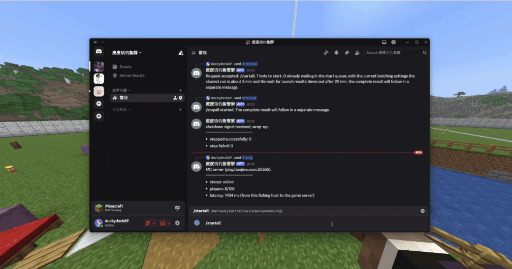

# Minecraft FishingBot Manager for Discord

**English** | [简体中文](docs/README/README-zh_cn.md)

> **Third-party project notice**
>
> This project is a third-party management tool and is not officially affiliated with the original FishingBot author. If you encounter any issue (bug) while using this project, please do not report it to the upstream author; report it through this project's [Issues](https://github.com/voiiku/minecraft-fishingbot-manager-for-discord/issues) instead.
>
> This project does not contain, modify, or distribute any FishingBot source code or binaries. Download the official JAR from the [FishingBot releases](https://github.com/MrKinau/FishingBot/releases).

* **Offline-mode servers and single-player worlds are not supported yet.**
* **This project runs only on 64-bit Linux for now.**
* Use a FishingBot build with `/status`, `/pause` and `/unpause`. Upstream plans to add pause commands in a future release ([issue](https://github.com/MrKinau/FishingBot/issues/291)).

## 1. Project overview

This project manages multiple Minecraft auto-fishing bots through a Discord server. The bots themselves come from the separate [FishingBot](https://github.com/MrKinau/FishingBot) project, and running `FishingBot.jar` requires a Java JRE.

In short, this project only provides a way to manage FishingBot instances; for now it does not implement the bot behaviour itself.

* Intended for players who fish while AFK on a Minecraft server, have several game accounts and want to manage them in one place.
* Not intended for single-player use.
* What this project solves:
  * It saves the cost of scattered AFK fishing (a group of friends fishing on their own machines costs far more than fishing in one place).
  * It makes several accounts easy to manage.
  * It covers the common needs: pausing fishing to act as a dummy player, sending commands to a bot, sending chat to the server, reading logs, and so on.

## 2. Deployment

See [docs/tutorial/tutorial-en_us.md](docs/tutorial/tutorial-en_us.md).

## 3. Command overview

Available to everyone:

* `/help`: the help menu. The whole text comes from `text.help` in the config, so you can set it yourself.
* `/whoami`: show the caller's Discord user ID.
* `/ping [host] [port]`: probe a game server; without arguments it uses the defaults in `[ping]`.
* `/checkserver`: show the fishing server's own performance (CPU, memory, disk, uptime).
* `/show status`: check running bots and anti-AFK thread status.
* `/show botconfig`: view the config file shared by all fishing bots, sent as an attachment.
* `/show mybots`, `/show allbots`, `/show admins`: view your own bots, all bots, or the administrator list.
* `/bot add <name>`: add a bot (a token is still required before it can be used).

Available to a bot's creator or an administrator:

* `/bot del <name>`, `/bot rename <old name> <new name>`: delete or rename a bot.
* `/bot login <name>`: sign in to a Microsoft account through a website and enter the code to obtain the bot token, which is saved on the server automatically; the bot starts automatically when the login succeeds.
* `/token <name>`: write a bot token by hand; not recommended.
* `/log <name> [lines]`: view a bot's newest log, sent as an attachment.
* `/start`, `/stop`, `/restart`: start, stop or restart one bot.
* `/pause`, `/unpause`: pause fishing without disconnecting, or resume it (depends on whether `FishingBot.jar` supports it; other features are unaffected).
* `/command <name> <command>`: send a command to the game server the bot is connected to.

`/show status` queries each bot's `/status` and shows all five fields. "Not paused" does not guarantee that the bot is
connected or fishing; `last_fish` is the Unix millisecond timestamp of the last fishing action, not necessarily a catch.
An unavailable response indicates an abnormal session; timeouts and query errors are reported separately. The manager
does not store state. Pause commands are followed by a query, which confirms the resulting state, not what caused it.

When upgrading, remove the obsolete `[command_echo]` table and `[keywords] online` from the manager configuration.

Available only to administrators:

* `/sync-commands`: update commands in the configured global or server scope and clean up old scopes.
* `/startall`, `/stopall`, `/restartall`, `/commandall <command>`: batch operations on all bots.
* `/pauseall`, `/unpauseall`: attempt to pause or resume fishing for bots with tokens and screen sessions.
* `/anti-afk <on|off>`: start or stop anti-AFK for matching screen sessions; check its status with `/show status`.

## 4. Project status

* Maintained by one person and still in testing; config fields and command replies change with updates, and incompatible changes are announced in the release notes.
* Only `ENGLISH` and `CHINESE_SIMPLIFIED` are supported for now (the names the FishingBot project uses).
* Out of scope: a web panel and a built-in proxy service.
* Future goals: support Windows, and a built-in fishing bot so you can choose between `FishingBot.jar` and the built-in one.

## 5. License

This project is licensed under the [MIT License](LICENSE).

Third-party licenses are listed in [THIRD-PARTY-NOTICES.html](THIRD-PARTY-NOTICES.html).

[FishingBot](https://github.com/MrKinau/FishingBot) is a separate program under the [GPL-3.0 license](https://github.com/MrKinau/FishingBot/blob/main/LICENSE). This project only manages it; it does not contain FishingBot or distribute it together with this project.

## 6. Contributing

Contributions are welcome. To report a bug or suggest a feature, [open an issue](https://github.com/voiiku/minecraft-fishingbot-manager-for-discord/issues). Pull requests are welcome too.

**A multilingual refactor is planned for the future.**

## 7. Documentation

See the [docs index](docs/index-en_us.md) for all documentation. The most frequently used documents are:

* [docs/tutorial/tutorial-en_us.md](docs/tutorial/tutorial-en_us.md): deployment from scratch, written for people new to Discord.
* [docs/troubleshooting/troubleshooting-en_us.md](docs/troubleshooting/troubleshooting-en_us.md): symptoms and checks when something goes wrong.
* [docs/mods/config/config-en_us.md](docs/mods/config/config-en_us.md): the config file, the loading process, every field, and startup validation.
